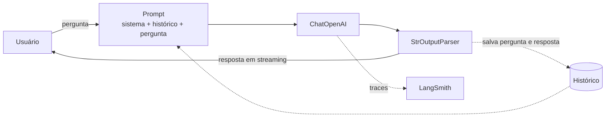
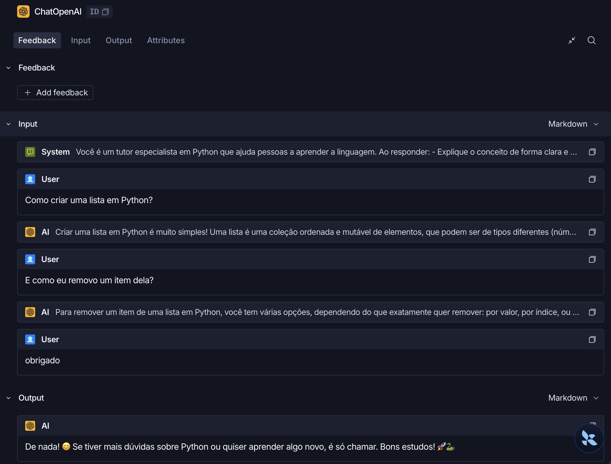
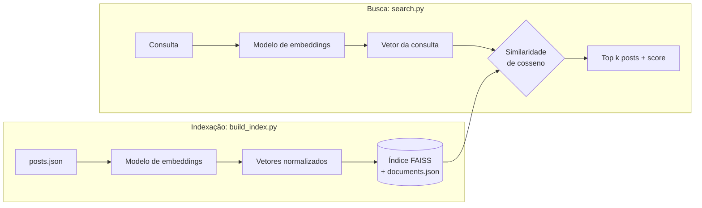

# Backend com IA: API, chatbot e busca semântica

Três projetos em Python, cada um em sua pasta, com código, testes e exemplos de execução: uma API REST de livros, um chatbot de programação com LangChain e uma busca semântica com embeddings e FAISS.

| Projeto | Pasta | Stack |
|---|---|---|
| 1. API de livros | [`q1_api_livros`](q1_api_livros) | FastAPI, SQLAlchemy, SQLite, pytest |
| 2. Chatbot de Python | [`q2_chatbot`](q2_chatbot) | LangChain, OpenAI, LangSmith |
| 3. Busca semântica | [`q3_busca_semantica`](q3_busca_semantica) | sentence-transformers, FAISS |

## Preparando o ambiente

Requer Python 3.10 ou superior (desenvolvido com 3.13).

```bash
python3 -m venv .venv
source .venv/bin/activate
```

Cada projeto tem seu próprio `requirements.txt`, já que a busca semântica depende do torch e os outros não:

```bash
pip install -r q1_api_livros/requirements.txt
pip install -r q2_chatbot/requirements.txt
pip install -r q3_busca_semantica/requirements.txt
```

---

## 1 — API de livros

```bash
cd q1_api_livros
uvicorn app.main:app --reload
```

A documentação interativa (Swagger) fica em http://127.0.0.1:8000/docs.

| Método | Rota | Descrição |
|---|---|---|
| `POST` | `/books` | Cadastra um livro |
| `GET` | `/books?title=&author=` | Busca por título e/ou autor |
| `GET` | `/books/{id}` | Detalha um livro |

**Decisões**
- A busca usa query params no mesmo endpoint, o que permite combinar os filtros. É parcial e não diferencia maiúsculas de minúsculas.
- `%` e `_` digitados pelo usuário são tratados como texto, não como curinga do `LIKE`.
- A listagem tem paginação (`skip`/`limit`, máximo de 100 por página).
- Os schemas de entrada e saída são separados do modelo do banco, então o cliente não consegue enviar campos como `id`.

**Testes**: `pytest -v` (17 testes). Rodam num SQLite em memória, sem tocar no banco real.

---

## 2 — Chatbot de Python

Copie o `.env.example` para `.env` e preencha a `OPENAI_API_KEY`.

```bash
cd q2_chatbot
python main.py          # chat interativo (/limpar e /sair)
python main.py --demo   # perguntas de exemplo
```

Exemplos de perguntas e respostas: [`q2_chatbot/EXEMPLOS.md`](q2_chatbot/EXEMPLOS.md).



**Decisões**
- A chain é montada com LCEL (`prompt | modelo | parser`) e mantém o histórico da conversa, então o bot entende perguntas como "e como removo um item dela?".
- O histórico é limitado às mensagens mais recentes, para controlar custo e tamanho do contexto.
- O system prompt restringe o assunto a Python; perguntas fora do tema são recusadas.
- As respostas aparecem em streaming no terminal.
- Com `LANGSMITH_TRACING=true` no `.env`, cada conversa é rastreada no LangSmith. No trace abaixo, o histórico da pergunta anterior chega ao modelo junto com a nova pergunta:



**Testes**: `pytest -v` (10 testes). Usam um LLM falso, então não precisam de chave nem de internet.

---

## 3 — Busca semântica

```bash
cd q3_busca_semantica
python build_index.py                     # gera embeddings e o índice FAISS
python search.py "quero viajar barato"    # uma consulta
python search.py --demo                   # consultas de exemplo
```

Resultados das consultas de exemplo: [`q3_busca_semantica/EXEMPLOS.md`](q3_busca_semantica/EXEMPLOS.md).



**Como funciona**
1. Os 12 posts de [`data/posts.json`](q3_busca_semantica/data/posts.json) são convertidos em vetores com o modelo multilíngue `paraphrase-multilingual-MiniLM-L12-v2` (título + conteúdo de cada post).
2. Os vetores são normalizados e armazenados num `IndexFlatIP` do FAISS. Com vetores normalizados, o produto interno equivale à similaridade de cosseno.
3. O índice e os documentos são salvos em `index/`, para a busca não precisar gerar os embeddings de novo.
4. Na busca, a consulta vira vetor e o FAISS retorna os posts mais próximos, com o score.

As consultas de exemplo não têm palavras em comum com o post esperado: "quero gastar menos no fim do mês" encontra "Como montar um orçamento pessoal", por exemplo.

Já usei similaridade de cosseno em produção num CRM pós-venda, para recomendar produtos a partir de produtos e clientes parecidos.

**Limitações e próximos passos**
- O `IndexFlatIP` faz busca exata, o que funciona bem para poucos documentos. Para milhões, um índice aproximado (HNSW ou IVF) seria mais adequado.
- Os posts são curtos e cabem inteiros no modelo. Textos longos precisariam ser divididos em pedaços (chunking) antes de gerar os embeddings.
- A busca sempre devolve `k` resultados, mesmo os pouco relevantes. Uma nota de corte ajudaria, mas precisa ser calibrada: nos exemplos, o resultado correto para a consulta sobre Docker teve score 0.38.
- Um modelo maior, como o `multilingual-e5` ou o `bge-m3`, tende a melhorar o ranking dos resultados após o primeiro.

**Testes**: `pytest -v` (13 testes, com um embedder falso) e `pytest -v -m integration` (1 teste com o modelo real).